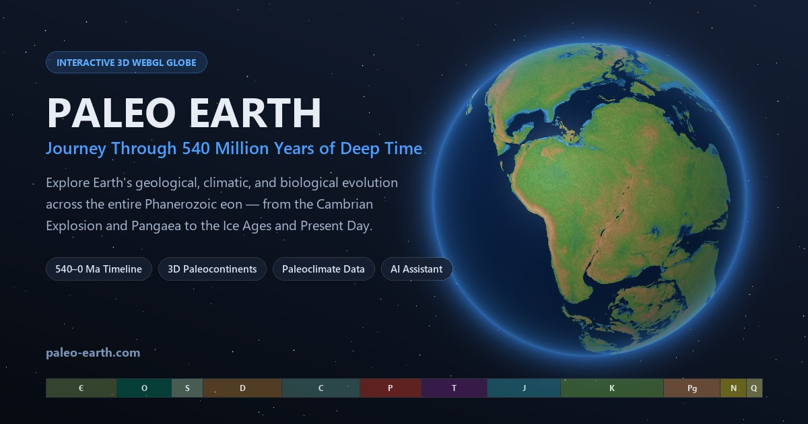

# Paleo Earth — Journey Through Deep Time

**Live Application:** [https://paleo-earth.com](https://paleo-earth.com)

**Paleo Earth** is an interactive 3D WebGL paleogeography, paleoclimate, and paleontology web application that lets users explore **540 million years of Earth's history** across the entire Phanerozoic eon—from the Cambrian Explosion (`540 Ma`) and the assembly of Pangaea to the Mesozoic age of dinosaurs, the Cenozoic Ice Ages, and the Holocene (`0 Ma`).



---

## Key Features

- **Interactive 3D Paleoglobe (Three.js / WebGL):**
  - Scrub seamlessly through **109 discrete paleogeographic reconstructions** at strict 5-million-year intervals (`0 Ma` to `540 Ma`).
  - Toggle **Modern Political Borders** projected onto ancient continental plates to track where modern countries sat in deep time.
  - Toggle **Interactive Paleocontinents** with outline overlays and real-time hover identification for ancient and modern landmasses (*Pangaea, Gondwana, Laurasia, Laurussia, Laurentia, Baltica, Siberia, Indian Subcontinent*, and modern continents).
  - Three selectable texture quality tiers (**High 4K/2K**, **Medium 2K/1K**, **Low 1K**) that hot-swap on the fly for desktop and mobile performance.
- **Geologic Time Scale (GTS) Scrubber & Keyframe Engine:**
  - Interactive timeline slider (`540 Ma` to `Today`) paired with an ICS-calibrated **Geologic Time Scale ribbon** covering all 12 Phanerozoic periods (**Cambrian, Ordovician, Silurian, Devonian, Carboniferous, Permian, Triassic, Jurassic, Cretaceous, Paleogene, Neogene, Quaternary**).
  - **46 curated keyframes**: 35 sub-period stages (Early, Middle, Late) and 11 major evolutionary and mass extinction events (*Cambrian Explosion, Great Ordovician Biodiversification Event, End-Ordovician Mass Extinction, Late Devonian Mass Extinction, Carboniferous Rainforest Collapse, Permian-Triassic "Great Dying", Triassic-Jurassic Mass Extinction, Mesozoic Marine Revolution, K-Pg Mass Extinction, Paleocene-Eocene Thermal Maximum, Eocene-Oligocene Transition*).
  - Built-in **Play / Pause animation engine** that traverses all 540 million years in a smooth 24-second cinematic loop.
- **Paleoclimate Gauges ($\text{O}_2$, $\text{CO}_2$, Global Temperature):**
  - Real-time animated gauges displaying atmospheric oxygen ($\text{O}_2$ %), carbon dioxide ($\text{CO}_2$ ppm), and global mean surface temperature ($^\circ\text{C}$) for every keyframe, adapting automatically between desktop SVG arc gauges and mobile bar gauges.
- **Encyclopedia & Context-Aware AI Assistant:**
  - **Period Information Tab:** In-depth, illustrated articles covering Overview, Climate, Geography, Flora, Fauna, and evolutionary milestones, complete with lightbox-expandable paleoart and fossil photography from Wikimedia Commons.
  - **Ask Questions Tab:** A context-aware AI assistant powered by **AWS Lambda** and **Amazon Bedrock (Claude)** that anchors its answers to whichever geological era or extinction event the user is currently viewing on the globe.
- **Neural Text-to-Speech (TTS) Narration:**
  - Every summary card, encyclopedia article, and AI chatbot response can be read aloud using **Amazon Polly Neural Voices** (*Matthew* and *Joanna*), combining pre-synthesized static audio for instant wiki/summary playback with on-demand serverless synthesis for chat responses.

---

## Technical Architecture

### 1. Frontend & 3D Rendering Engine (`js/`)
The frontend is built with **native ES Modules** and **Three.js (`v0.168`)** via browser `<script type="importmap">`, requiring **zero bundler or build step**.

- **Custom GLSL Shader Pipeline ([`js/globe.js`](js/globe.js)):**
  - Extends Three.js's `MeshStandardMaterial` via `onBeforeCompile` to inject custom fragment shader stages directly into the PBR lighting pipeline:
    1. **Shadow-Lift Gamma Correction:** Applies a power curve (`GLOBE_SHADOW_LIFT_GAMMA = 0.80`) to diffuse albedo channels so deep topographic hillshade trenches remain legible under directional sunlight.
    2. **Political Border Compositing:** Samples a high-contrast border mask (`bordersMap`) and mixes crisp vector borders over the terrain.
    3. **Paleocontinent Outlines & Additive Hover Glow:** Samples `continentOutlineMap` and `continentIdMap` in the fragment shader, applying an additive highlight glow (`hoveredContinentUiColor`) to all pixels matching the currently hovered continent's RGB signature.
  - A secondary outer sphere mesh (`1.038×` radius, `THREE.BackSide`, additive blending) runs a custom vertex/fragment **Atmospheric Fresnel Shader** (`pow(1.0 - dot(vNormal, vViewDir), 2.8)`) to produce a physically inspired atmospheric limb glow.
- **GPU Texture Cache & Lookahead Preloader ([`js/globe.js`](js/globe.js), [`js/config.js`](js/config.js)):**
  - Manages a bounded **LRU GPU Texture Cache** (`TEXTURE_CACHE_SIZE = 16` full frames, where each frame comprises diffuse, normal, and roughness maps) and explicitly calls `.dispose()` on evicted Three.js textures to prevent WebGL VRAM exhaustion when scrubbing across 109 4K frames.
  - Implements **bidirectional lookahead preloading** (`±1` to `+3` frames ahead of scrub/playback direction) so timeline playback runs without frame hitching.
- **Spherical UV Raycasting & Color-ID Picking ([`js/globe.js`](js/globe.js), [`js/app.js`](js/app.js)):**
  - When Paleocontinents mode is active, pointer movement casts a `THREE.Raycaster` ray against the globe mesh to obtain the exact spherical `uv` intersection.
  - The `uv` coordinate is sampled against an offscreen 2D `<canvas>` holding the current time slice's `earth_continent_id_2k_<index>.png` map, using Euclidean RGB distance matching to identify and highlight ancient continents in $O(1)$ time without needing 3D polygon meshes for all 109 time steps.

### 2. Serverless Backend & Cloud Infrastructure ([`template.yaml`](template.yaml), [`lambda/handler.py`](lambda/handler.py))
- **Content Delivery & Security:**
  - Static assets, textures, images, and pre-baked audio are hosted in **private Amazon S3 buckets** (`BlockPublicAccess = true`) fronted by **Amazon CloudFront** using **SigV4 Origin Access Control (OAC)**, **Route 53** DNS, and **AWS Certificate Manager (ACM)** TLS certificates.
  - Environment-aware routing in [`js/config.js`](js/config.js) automatically directs `paleo-earth.com` to the Production API Gateway stage (`/prod`) and `dev.paleo-earth.com` / `localhost` to the Staging stage (`/staging`).
- **API Gateway & AWS Lambda ([`lambda/handler.py`](lambda/handler.py)):**
  - Defined as Infrastructure-as-Code via **AWS SAM** ([`template.yaml`](template.yaml)) running on **Python 3.11**.
  - **`POST /chat`**: Accepts the user's conversation history plus the active keyframe's `systemPromptContext`, constructs an era-grounded system prompt, and invokes **Claude** (via Amazon Bedrock / Anthropic API) to return paleontologically accurate responses.
  - **`POST /tts`**: Strips markdown formatting, chunks text safely under Amazon Polly's character limits, synthesizes neural speech via `polly:SynthesizeSpeech` (`Engine="neural"`, `OutputFormat="mp3"`), and returns base64-encoded audio to the client's [`TTSController`](js/tts.js).

### 3. Data & Asset Generation Pipeline (`scripts/`)
Offline Python scripts used to build the paleogeographic textures, climate curves, audio files, and image datasets:
- [`scripts/colorize_paleodem.py`](scripts/colorize_paleodem.py) & [`scripts/paleodem_heightmap.py`](scripts/paleodem_heightmap.py) — Converts PALEOMAP NetCDF (`.nc`) PaleoDEM elevation/bathymetry grids into 4K/2K/1K diffuse, normal, and specular roughness maps.
- [`scripts/process_border_svgs.py`](scripts/process_border_svgs.py) & [`scripts/generate_continent_outlines.py`](scripts/generate_continent_outlines.py) — Rasterizes paleocontinent color-ID maps and anti-aliased continent/border overlays across all 109 frames.
- [`scripts/process_climate_data.py`](scripts/process_climate_data.py) — Extracts and interpolates Phanerozoic $\text{O}_2$, $\text{CO}_2$, and paleotemperature time series into [`data/keyframes.json`](data/keyframes.json).
- [`scripts/generate_summary_audio.py`](scripts/generate_summary_audio.py) & [`scripts/generate_wiki_audio.py`](scripts/generate_wiki_audio.py) — Batch-synthesizes Amazon Polly neural `.mp3` narrations for all 46 keyframes in both `Matthew` and `Joanna` voices.
- [`scripts/scrape_wikipedia_pages.py`](scripts/scrape_wikipedia_pages.py) & [`scripts/scrape_holocene_pages.py`](scripts/scrape_holocene_pages.py) — Fetches, sanitizes, and attributes Creative Commons paleoart and fossil imagery via the Wikimedia Commons API.

---

## Project Structure

```text
Paleo Earth/
├── index.html                  # Main application shell, SEO metadata, & JSON-LD schema
├── maintenance.html            # Standalone maintenance mode page
├── style.css                   # Responsive dark-space UI & mobile/desktop layout styles
├── template.yaml               # AWS SAM template (Lambda, API Gateway, IAM, CloudWatch)
├── robots.txt & sitemap.xml    # Search engine crawler configuration
├── js/
│   ├── app.js                  # Application bootstrap, UI wiring, wiki renderer, & continent picking
│   ├── config.js               # Environment routing, texture paths, continent RGB LUT, & GTS config
│   ├── globe.js                # Three.js WebGL globe, custom shaders, & LRU texture preloader
│   ├── slider.js               # Timeline scrubber, GTS ribbon builder, & playback loop
│   ├── gauges.js               # SVG arc gauges (desktop) & bar gauges (mobile) for O2/CO2/Temp
│   ├── chat.js                 # Context-aware AI chat controller & context divider management
│   └── tts.js                  # Hybrid static/dynamic Amazon Polly audio playback controller
├── data/
│   ├── keyframes.json          # 46 period & event keyframes (Ma, climate data, AI prompt context)
│   ├── summaries.json          # Concise era & event summaries
│   └── wiki.json               # Illustrated multi-section encyclopedia articles & image credits
├── lambda/
│   ├── handler.py              # AWS Lambda entry point for /chat and /tts endpoints
│   └── requirements.txt        # Python Lambda dependencies
├── textures/
│   ├── high/                   # 4K diffuse & borders, 2K normal & roughness maps (frames 1–109)
│   ├── medium/                 # 2K diffuse & borders, 1K normal & roughness maps (frames 1–109)
│   ├── low/                    # 1K diffuse, borders, normal & roughness maps (frames 1–109)
│   ├── continents_color_id/    # 2K RGB color-ID lookup maps for paleocontinent picking
│   └── continents_outlines/    # 2K colored paleocontinent border overlays
├── images/
│   ├── paleo_art/              # Curated Wikimedia Commons paleoart & fossil reconstructions
│   └── wikipedia_images/       # Period- & event-specific Wikimedia Commons illustrations
├── audio/
│   ├── summaries/              # Pre-generated Polly neural MP3s for keyframe summaries
│   └── wiki/                   # Pre-generated Polly neural MP3s for encyclopedia articles
└── scripts/                    # Offline Python asset-processing & data-scraping utilities
```

---

## Running Locally

Because the frontend uses native ES modules and an import map, no build step or `npm install` is required to run the client:

```bash
# Serve the root directory over HTTP
python -m http.server 8000
```

Then open `http://localhost:8000` in your browser. *(When running on `localhost`, [`js/config.js`](js/config.js) automatically routes API requests to the staging API Gateway endpoint; you can also set `DEV_MODE = true` in [`js/config.js`](js/config.js) for offline mock responses.)*

---

## Data Sources & Scientific Credits

- **Paleogeographic Reconstructions & PaleoDEMs:** Based on the **PALEOMAP Project** by Christopher R. Scotese and Nicky Wright.
- **Atmospheric Oxygen ($\text{O}_2$) Curve:** Mills et al. (2023) / GEOCARBSULF.
- **Paleotemperature Curve:**
  - Scotese, C. R., Song, H., Mills, B. J. W., & van der Meer, D. G. (2021). *Phanerozoic paleotemperatures: The earth's changing climate during the last 540 million years.* Earth-Science Reviews, 215, 103503.
  - Valdes, P. J., Scotese, C. R., & Lunt, D. J. (2021). *Deep Ocean Temperatures through Time.* Climate of the Past Discussions.
- **Atmospheric $\text{CO}_2$ Trajectory:** CenCO2PIP Consortium (2023) and Foster et al. (2017).
- **Paleoart & Fossil Photography:** Sourced via Wikimedia Commons under Creative Commons licenses, with individual artist attributions embedded in each article caption.

---

## Author

Created by **Axel Eriksen**
- **X:** [@axeleriksendev](https://x.com/axeleriksendev)
- **GitHub:** [Voltfest42](https://github.com/Voltfest42)
- **Support the Project:** [Buy Me a Coffee](https://buymeacoffee.com/paleoearth)
